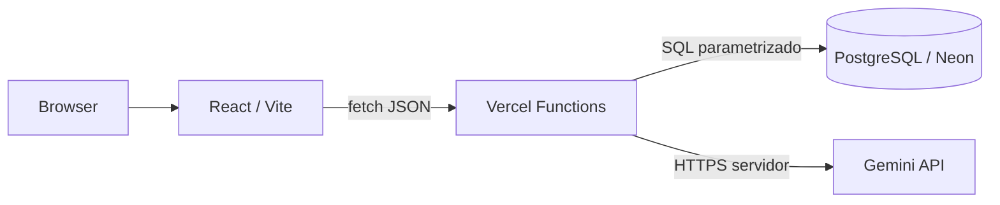
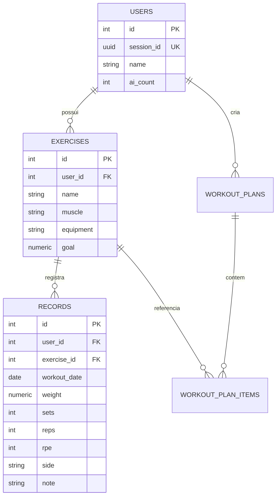

# LiftTrack AI

**Seu treino. Sua evolução.** Diário web de musculação para registrar cargas, séries, repetições e esforço percebido, consultar histórico e interpretar dados fictícios com inteligência artificial.

Projeto Integrador — Desenvolvimento Web para IA + Banco de Dados. Entrega prevista no edital: 04/12/2026. Integrantes: preencher os três nomes e a participação real de cada pessoa antes da entrega.

## 1. O que existe

Interface React/Vite responsiva, sete áreas: visão geral, modo treino, criar treino, histórico, evolução, inteligência e ferramentas. Cadastro/edição de exercícios e metas, registros de carga com edição/exclusão, comparação de períodos e lados, gráfico, volume, recordes de carga, estabilidade, retrospectiva, cronômetro, mapa muscular esquemático, calculadora de anilhas, exportação CSV e impressão em PDF pelo navegador. Ditado depende de Web Speech API. Importação de texto/foto por Gemini e assistente contextual dependem de configuração. Contador de ciclos de movimento por câmera é experimental, não reconhece exercícios nem é contador biomecânico validado. Não prescreve carga nem substitui profissional.

A versão HTML separada é **demonstração local**, usa dados fictícios e localStorage quando disponível; importação textual é uma regra simples explicitamente rotulada. Ela NÃO atende por si só ao edital. A versão Vite de produção, por padrão, não usa mock nem localStorage: usa rotas reais `/api/data` e `/api/ai`. Não existe fallback falso para IA ou banco.

## 2. Instalação e configuração (Windows/macOS/Linux)

Pré-requisitos: Node.js 22 LTS (mínimo 20.19), npm, Git, conta Neon e Vercel. Para IA, conta Google AI Studio e chave com acesso a modelo Gemini multimodal disponível para seu projeto. Verifique cotas e termos gratuitos antes de usar: nenhuma cobrança é exigida pelo edital; não habilite faturamento pago sem autorização. Os modelos disponíveis variam, por isso `AI_MODEL` não vem fixado. Não use informações pessoais ou fotos reais.

1. Extraia o ZIP e abra a pasta `lifttrack` no VS Code. Rode `npm install`. O lockfile será criado; mantenha-o no Git.
2. Crie um banco PostgreSQL no Neon, copie a conexão e execute `sql/schema.sql` em SQL Editor. Execute `sql/seed.sql` para os dados fictícios da auditoria. Para a interface, cada navegador recebe perfil fictício isolado e catálogo inicial, sem registros; cadastre seus próprios registros de teste. Os dados do seed SQL não aparecem no perfil do navegador.
3. Copie `.env.example` para `.env.local` (no PowerShell: `Copy-Item .env.example .env.local`). Preencha:

```dotenv
DATABASE_URL=postgresql://...
AI_API_KEY=chave_do_google_ai_studio
AI_MODEL=identificador_de_modelo_gemini_disponivel
AI_ENABLED=true
VITE_LOCAL_DEMO=false
```

Nunca adicione `.env.local` ao Git. Não utilize prefixo `VITE_` para segredos. `AI_ENABLED=false` desabilita a IA sem impedir o uso do registro. Para rodar com funções serverless em ambiente local, use `npm run dev:api` (`vercel dev`, faça login e vincule o projeto se solicitado). Acesse a URL indicada no terminal, usualmente http://localhost:3000. Caso o Vercel CLI não carregue as variáveis locais, configure-as no projeto Vercel e use `npx vercel env pull .env.local`. O comando `npm run dev` sozinho serve apenas o frontend, não as APIs; para demonstração Vite local, use `VITE_LOCAL_DEMO=true` no `.env.local`, nunca em produção. Use o HTML autônomo para testar sem instalar dependências.
4. Execute `npm test` e `npm run build`. Em seguida teste as rotas reais e F5. `npm test` cobre lógica pura, não comprova banco ou IA.

## 3. Publicação

Crie um repositório GitHub único. Cada integrante deve fazer commits reais com sua conta, em dias diferentes; não invente histórico. Importe o repositório no Vercel (framework Vite, build `npm run build`, saída `dist`). O diretório `api/` será exposto como Vercel Functions. Configure `DATABASE_URL`, `AI_API_KEY`, `AI_MODEL`, `AI_ENABLED=true` em Project Settings > Environment Variables (Production; Preview se necessário). Não marque `VITE_LOCAL_DEMO=true`. Faça redeploy. Abra a URL gerada; teste APIs, cadastro, F5 e IA. O link só deve ser informado após a publicação e verificação reais.

```sh
git init
git add .
git commit -m "chore: inicia LiftTrack"
git branch -M main
git remote add origin URL_DO_REPOSITORIO
git push -u origin main
```

Antes de abrir a demonstração publicamente, configure proteção e limites de requisições/IP do serviço de hospedagem/provedor conforme plano disponível. A API limita 10 chamadas por perfil e 60 chamadas globais por janela de 24 horas; a criação de perfis tem limite global de 500 por janela. Esses tetos são decisões de implementação, não garantia contra abuso ou cobrança. Para uso de avaliação, monitore quota ou mantenha IA desligada quando não estiver demonstrando. Não é sistema de produção comercial nem autenticação pessoal.

## 4. Arquitetura



`src/app.js`: componentes de interface. `src/core.js`: lógica compartilhada. `api/data.js`: GET leitura e criação de sessão; POST operações de exercício, registro, exclusão e lote. `api/ai.js`: análise e extração estruturada. `lib/server.js`: validação, conexão, sessão isolada e SQL. `sql/`: DDL, seed e consultas. `tests/`: testes unitários. `docs/`: relatório base, evidências e roteiro.

Sessão por UUID aleatório em cookie HttpOnly, SameSite=Lax, Secure em Vercel; o banco aplica FKs compostas para impedir vínculo entre exercícios de perfis diferentes. Não é login: apagar cookie perde acesso ao perfil anterior. As rotas exigem JSON nas mutações e verificam origem quando fornecida. Chaves apenas no servidor. Operações destrutivas filtradas pelo perfil. Validação no frontend, backend e banco. Sem envio de notas pessoais ao modelo; fotos/anotações devem ser fictícias; o reconhecimento de voz pode usar serviço do navegador. Câmera processada localmente.

## 5. Banco e consultas



A FK de `records` é composta (`user_id`, `exercise_id`) e aponta para a chave única equivalente em `exercises`; a outra FK liga `exercises.user_id` a `users.id`. As operações em registros implementam CRUD completo. Execute `sql/queries.sql` por partes: JOIN, agregação, EXPLAIN antes, CREATE INDEX, ANALYZE, EXPLAIN depois. O índice `(user_id, workout_date DESC)` é coerente com consultas de histórico ordenado por data. Não invente ganho: com poucos dados, PostgreSQL pode usar Seq Scan. Guarde prints e tempos reais.

## 6. IA

Importação: descreva uma anotação (ex.: `Supino reto 30 kg, 3 séries de 12; Rosca direta 10 kg, 3 x 10`), ou selecione uma imagem fictícia até 1,5 MB. A API consulta o catálogo do próprio perfil, chama o modelo configurado e pede JSON com ID, carga, séries e repetições. Dados inválidos são descartados; o usuário revisa e confirma. Apenas após confirmação, a rota de lote salva os registros em transação. A data padrão é hoje; altere após salvar se a sessão ocorreu em outro dia. Sem IA configurada, a API retorna erro claro. Análise: envia até 150 registros recentes sem notas e estatísticas calculadas pelo código. Não use respostas como prescrição ou garantia de progresso.

## 7. Limites e estado da entrega

Testes unitários executados na v3: 12 passam. Teste em memória da v3: preferências, ficha gerada, ficha salva e aberta, duas séries independentes, sem erros JS. Interface HTML carregada e exercitada em Chromium com injeção do conteúdo (cadastro, edição, histórico, evolução, importação por regras, calculadora e navegação em viewport mobile); sem erros JS nesses fluxos. Navegação direta por arquivo/localhost foi bloqueada pela política do ambiente de desenvolvimento; persistência após F5, Safari, microfone/câmera, impressão, API externa e deploy não foram verificados aqui. As dependências do pacote de produção não estavam instaladas neste ambiente, a tentativa de npm install falhou por DNS EAI_AGAIN; portanto o build Vite não foi executado. Nenhum banco Neon, chave Gemini, repositório GitHub ou deployment Vercel foi provisionado. Não apresente evidências que não foram obtidas. A demo HTML usa React/ReactDOM 16 UMD já disponíveis no ambiente, a produção usa React 18.

Para fechar o edital, use o checklist de `docs/VALIDACAO.md`. O relatório técnico ainda precisa de nomes, resultados e prints verificáveis. Data limite: 04/12/2026.

## Criador de treino e atualização v3

Na aba **Criar treino**, use um objetivo fictício em linguagem natural, indique tempo, nível, grupo muscular, equipamento, intensidade e condição. A rota `POST /api/ai` (modo `plan`) chama o modelo Gemini configurado e valida a estrutura retornada, IDs, séries, repetições, descansos e limites de intensidade. Sem a configuração de IA, a versão de produção informa erro; a demo HTML gera exemplos determinísticos por regras locais, claramente identificados como não IA.

Para banco novo, execute somente `sql/schema.sql` e `sql/seed.sql`. Para banco v2 já existente com coluna `plan` JSONB, faça backup e execute `sql/migration_03_normalize.sql` uma única vez. Para banco v1 sem fichas, execute primeiro a migração histórica `sql/migration_02_plans.sql` e depois a 03. A v3 possui cinco tabelas de domínio mais `service_limits` (operacional). Os itens da ficha têm FKs compostas para plano e exercício do mesmo perfil. O salvamento dos itens e do cabeçalho é atômico em uma instrução SQL. A ficha não guarda texto de saúde. Iniciar ficha abre o registro sem criar execução fictícia automaticamente. A ação Registrar apenas uma série salva uma linha com `sets=1`, permitindo pesos e repetições distintos.

O botão Preencher preferências pelo texto utiliza Gemini em produção (modo `preferences`) e regras locais na demo ou quando há referência a saúde. Revise os campos e informe condição atual; a IA não altera saúde ou liberação. A geração considera até 40 registros recentes apenas como contexto de familiaridade, sem prescrever pesos.

A checagem de condição é autodeclarada e limitada, não é triagem médica. Sintomas ativos e sinais de alerta bloqueiam geração; retorno pós-doença/lesão exige recuperação e liberação profissional informadas, reduz a intensidade e o tempo disponível (até 20 min). Não use informações pessoais/médicas reais. O retorno deve ser gradual e orientado, não há liberação clínica automática. Referência de segurança: Return to Play After Infectious Disease — https://pmc.ncbi.nlm.nih.gov/articles/PMC7123245/ .

Evidências adicionais a produzir no ambiente configurado: chamada real Gemini com cenário fictício; consulta `SELECT p.id,p.title,i.exercise_id,i.position FROM workout_plans p JOIN workout_plan_items i ON i.plan_id=p.id;` após salvar/recarregar; teste de bloqueio por sintomas; abertura do treino salvo, registro real de carga fictícia e teste de exclusão. A migração, a IA e o deploy não foram executados remotamente neste ambiente. Não apresentar a demo como persistência SQL ou IA real.

## Evidências e testes SQL
Veja `docs/diagrama-banco.png`, `docs/RELATORIO_BASE.md`, `docs/VALIDACAO.md` e arquivos registrados em `docs/evidencias/`. Execute `sql/acceptance.sql` em banco de teste para verificar FKs, CHECK, séries e exclusão em cascata (rollback final). Antes/depois do EXPLAIN devem ser rodados em banco sem o índice inicialmente; não remova índice de produção. Resultados SQL e Gemini ainda pendentes.
